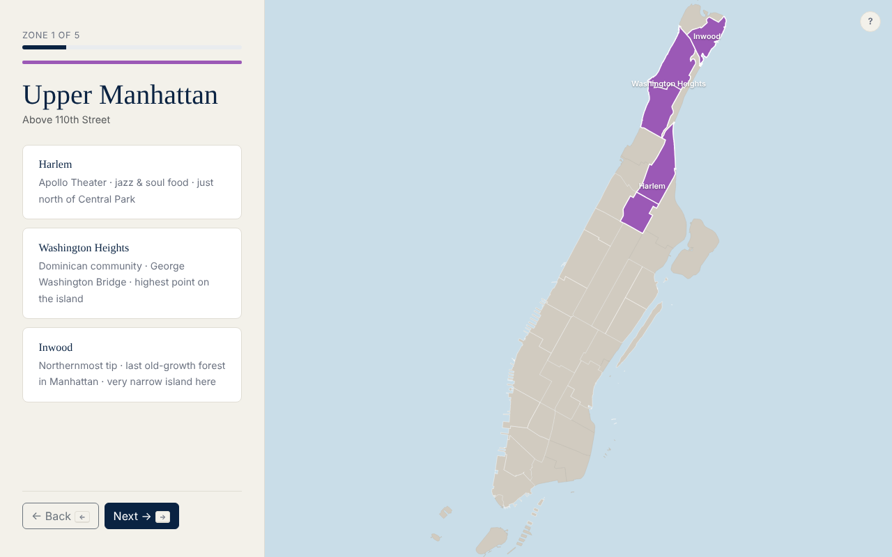
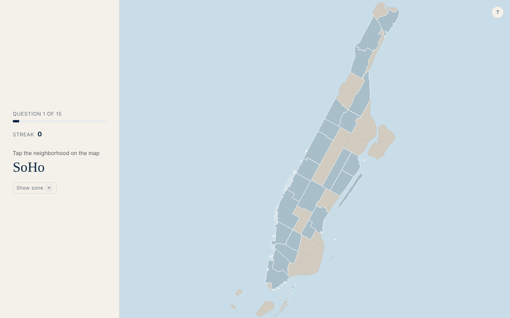

# NYC Neighborhoods

**Learn Manhattan's neighborhoods on an interactive map, then test yourself.**

Most people new to New York know a few names but couldn't point to them on a map. This app teaches 15 Manhattan neighborhoods in five zones, from Inwood down to the Financial District, then quizzes you by having you click each one on the map.




## Features

- **Zone-by-zone lessons.** Each zone highlights its neighborhoods on a D3 map of Manhattan, with a quick fact for each.
- **Map quiz.** You're given a neighborhood name and click it on the map. Questions are shuffled, and your streak is tracked.
- **Hints.** "Show zone" highlights the right area. Using a hint or missing costs you points.
- **Results.** A score out of 30 (2 points for a first-try answer, 1 point after a miss or hint) and a per-neighborhood breakdown with each zone shown on the map.
- **Keyboard-friendly.** Arrow keys, Enter, and H move through the whole flow.

## Tech

Python · Flask · Jinja templates · D3.js (GeoJSON rendering) · Bootstrap

Quiz state lives in the Flask session, so there's no database. Neighborhood boundaries are GeoJSON, and the lesson and quiz content is in `data.json`.

## Run it

```bash
pip install -r requirements.txt
flask --app app run
```

Then open http://localhost:5000. Set `SECRET_KEY` in the environment for anything beyond local use.

## Team

Built by Eli Werstler and Duncan Greene for Columbia's User Interface Design course.
Eli built most of the front end: the learn, quiz, and results pages and their map interactions.

Demo videos: [Eli](https://youtu.be/3nnp9VNPEKI) · [Duncan](https://youtu.be/1U7UTFmnXCc)
